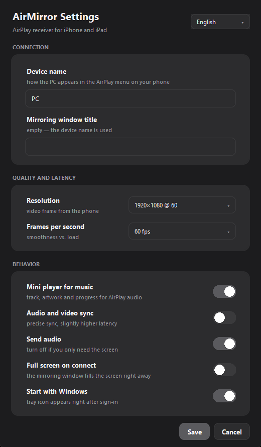
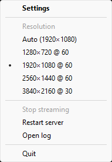
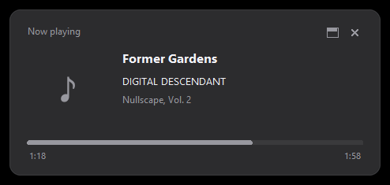

# AirMirror

AirMirror turns a Windows PC into an AirPlay receiver. It lives in the system
tray and uses [UxPlay](https://github.com/FDH2/UxPlay) under the hood, so an
iPhone, iPad or Mac can mirror its screen or stream audio to the PC over the
local network.

> AirMirror is an unofficial project. It is not affiliated with, endorsed by, or
> sponsored by Apple Inc. “AirPlay” is a trademark of Apple Inc. and is used here
> only to describe the protocol.



## Features

- **Tray-only app** — no main window; the server starts with the tray icon.
- **Screen mirroring** — the mirroring window appears only when a device connects.
- **Mini player** — artwork, track, artist, album and progress for AirPlay audio,
  with an “Always on top” pin and a Windows 11-style close button.
- **Quality controls** — resolution, frame rate and audio/video sync.
- **Bilingual UI** — English (default) and Russian, switchable in Settings.
- **Autostart** — optional “Start with Windows”.
- **Self-contained installer** — bundles UxPlay and GStreamer; no MSYS2 needed
  on the target PC.

| Tray menu | Mini player |
|---|---|
|  |  |

## Requirements

- Windows 10 or Windows 11, 64-bit.
- iPhone, iPad or Mac on the same local network.
- The network profile must be **Private** (Windows blocks discovery on Public
  networks).
- Inbound mDNS (UDP 5353) and the UxPlay ports must not be blocked by a firewall.

## Install

1. Download `AirMirror-Setup-1.0.0.exe` from [Releases](../../releases).
2. Run the installer. It asks for administrator rights once and installs to
   `C:\Program Files\AirMirror`.
3. The installer creates an inbound firewall rule for `uxplay.exe` and optional
   desktop/Start-menu shortcuts.
4. Launch **AirMirror** from the Start menu or the desktop shortcut.

The installer is not code-signed, so Windows SmartScreen may show
“Windows protected your PC”. Choose **More info → Run anyway**.

## Use

1. Start AirMirror. A tray icon appears; UxPlay starts in the background.
2. On the iPhone/iPad open **Control Center → Screen Mirroring** and pick the
   device name (the PC name by default). On a Mac use the AirPlay menu in the
   menu bar.
3. The mirroring window opens on the PC.
   - `Alt+Enter` — toggle full screen.
   - `Ctrl+C` in the mirroring window — stop the session.
4. Right-click the tray icon to open Settings, change resolution, stop the
   stream, restart the server, open the log or quit.

## Settings

Right-click the tray icon → **Settings**.

| Setting | Description |
|---|---|
| Device name | How the PC appears in the AirPlay menu on the phone. |
| Mirroring window title | Optional window title; empty uses the device name. |
| Resolution | Video frame from the phone: Auto (1920×1080), 1280×720@60, 1920×1080@60, 2560×1440@60 or 3840×2160@30. |
| Frames per second | 30 or 60 fps. |
| Audio and video sync | More precise sync with slightly higher latency. |
| Send audio | Turn off if you only need the screen. |
| Full screen on connect | The mirroring window fills the screen right away. |
| Mini player for music | Show the now-playing card during AirPlay audio. |
| Start with Windows | Add AirMirror to `HKCU\Software\Microsoft\Windows\CurrentVersion\Run`. |
| Language | English or Russian. Applied after saving. |

`Enter` saves, `Esc` closes. Connection and quality changes restart the UxPlay
server; other settings apply immediately.

### Mini player

The card shows the album cover, track title, artist, album, elapsed time and
duration. It has no taskbar button and does not steal focus.

- The pin button toggles **Always on top** (off by default).
- The close button hides the card until the next track.
- The card hides automatically when audio stops or screen mirroring starts.
- Its position is remembered between tracks.

## Data and logs

Settings and runtime files live in `%APPDATA%\AirMirror`:

| File | Purpose |
|---|---|
| `settings.json` | User settings. |
| `uxplay.log` | UxPlay output; also opened by **Open log**. |
| `tray-error.log` | Python traceback if the tray app crashes. |
| `nowplaying.txt`, `coverart.bin` | Metadata and artwork written by UxPlay. |
| `airmirror.ico` | Cached application icon. |

To reset the app, quit it, delete `settings.json` and start it again.

## Build from source

### Prerequisites

- Python 3.11+ with `pystray`, `Pillow` and `pyinstaller`.
- [MSYS2](https://www.msys2.org/) with the UCRT64 environment and UxPlay +
  GStreamer installed (UxPlay source is in `third_party/uxplay`).
- [Inno Setup 6](https://jrsoftware.org/isinfo.php).

### One command

```bat
build-installer.cmd
```

The script freezes the Python app, builds the portable UxPlay/GStreamer bundle
and compiles the installer. If MSYS2 is not in `C:\msys64`, set `MSYS2_ROOT`
first:

```bat
set MSYS2_ROOT=D:\msys64
build-installer.cmd
```

### Manual steps

```bat
python -m PyInstaller --noconfirm --clean AirMirror.spec
```

Then, inside MSYS2 UCRT64:

```sh
bash build-portable.sh
```

Finally compile `installer.iss` with Inno Setup 6 (or run `ISCC.exe installer.iss`).
The result is `installer\AirMirror-Setup-1.0.0.exe`.

The portable bundle is written to `build\portable\uxplay` and the frozen app to
`dist\AirMirror`.

## Troubleshooting

**The PC does not appear in Screen Mirroring**

- Make sure both devices are on the same network and the Windows network profile
  is **Private**.
- Allow mDNS (UDP 5353) and `uxplay.exe` through Windows Firewall. The installer
  adds a rule named **AirMirror (UxPlay)**; `setup-firewall.cmd` can recreate it.
- Only one AirPlay receiver can run on a PC at a time. Quit other receivers
  (AirPlay Receiver, shairport-sync, etc.) before starting AirMirror.
- VPN, Hyper-V and other virtual adapters can confuse mDNS. AirMirror ships a
  patched mDNS resolver that prefers a real LAN adapter; if needed, force the
  address with the `UXPLAY_MDNS_ADDR` environment variable.

**The mirroring window is black or does not open**

Check `%APPDATA%\AirMirror\uxplay.log`. The bundled UxPlay uses the D3D12 video
sink; a recent GPU driver is recommended.

**The tray icon disappeared**

Start AirMirror again. If it reports that it is already running, look for the
icon in the hidden-icons area of the taskbar.

**SmartScreen blocks the installer**

The installer is unsigned. Use **More info → Run anyway**, or build it yourself
from source.

## Project layout

```text
AirMirror.py            tray app, settings, mini player, i18n
AirMirror.spec          PyInstaller spec
airmirror.ico           application icon
installer.iss           Inno Setup script
build-installer.cmd     full build pipeline (Windows)
build-portable.sh       UxPlay + GStreamer bundle (MSYS2 UCRT64)
setup-firewall.ps1      firewall/network helper
mdns_check.py           mDNS discovery diagnostic
third_party/uxplay/     UxPlay 1.74 source and local mDNS patch
licenses/               third-party license texts
docs/                   screenshots
```

## License

AirMirror’s own code is released under the [MIT License](LICENSE).

UxPlay is licensed under the GNU General Public License v3.0 and runs as a
separate process; AirMirror only starts and stops it. The installer also bundles
GStreamer and other third-party components. See
[THIRD_PARTY_NOTICES.md](THIRD_PARTY_NOTICES.md) and the `licenses/` directory
for details and full license texts.

## Credits

- [UxPlay](https://github.com/FDH2/UxPlay) — AirPlay server.
- [GStreamer](https://gstreamer.freedesktop.org/) — media pipeline.
- [pystray](https://github.com/moses-palmer/pystray) — tray icon.
- [Pillow](https://python-pillow.org/) — image handling.
- [PyInstaller](https://pyinstaller.org/) — Windows packaging.
- [Python](https://www.python.org/) — runtime.
